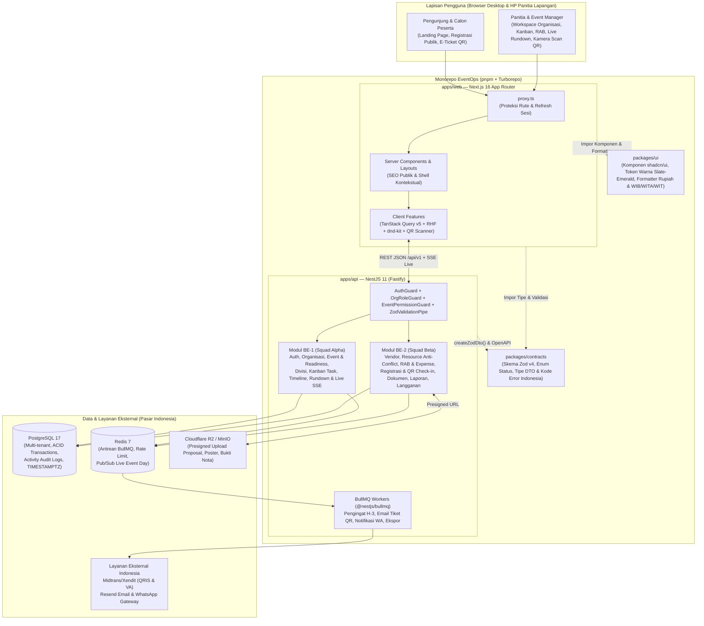

# 01 — Rekomendasi Tech Stack Powerful & Arsitektur Sistem (Pasar Indonesia)

Dokumen ini merinci arsitektur teknis dan pemilihan teknologi terbaik untuk **EventOps Indonesia**, dirancang khusus agar:
1. **Kuat menangani kompleksitas operasional nyata** (multi-organisasi, multi-event, ribuan task, deteksi bentrok inventaris, persetujuan anggaran Rupiah, live rundown hari-H, dan antrean scan QR peserta serentak).
2. **Nyaman dan cepat dikerjakan oleh tim 4 orang (2 Backend + 2 Frontend)** tanpa tumpang-tindih kode berkat pendekatan **Monorepo + Shared Zod Contracts**.
3. **Siap penuh untuk ekosistem Indonesia** (pembayaran lokal QRIS/Virtual Account, notifikasi WhatsApp & Email panitia, zona waktu WIB/WITA/WIT, presisi mata uang Rupiah, dan kepatuhan UU PDP).

---

## 1. Ringkasan Tech Stack Utama

### A. Manajemen Repositori & Monorepo
| Komponen | Teknologi yang Direkomendasikan | Alasan Teknis & Manfaat untuk Tim 4 Orang |
| :--- | :--- | :--- |
| **Package Manager** | **pnpm 10+** | Hemat ruang disk, instalasi sangat cepat, dan *strict node_modules* mencegah import paket tersembunyi antarmodul. |
| **Build System** | **Turborepo 2.x** | Orkestrasi task paralel (`dev`, `build`, `lint`, `check-types`, `test`) dengan *caching* cerdas. Saat `packages/contracts` berubah, baik `apps/web` maupun `apps/api` langsung tervalidasi tipe datanya dalam hitungan detik. |
| **Runtime & Bahasa** | **Node.js 22 LTS + TypeScript 5.9 (`strict`)** | Satu bahasa dari ujung database sampai komponen UI; tidak ada biaya mental pindah bahasa ketika mendiskusikan kontrak API antara FE dan BE. |

### B. Frontend Stack (`apps/web` — Dipegang oleh FE-1 & FE-2)
| Lapisan | Teknologi | Detail Penggunaan di EventOps |
| :--- | :--- | :--- |
| **Framework Utama** | **Next.js 16 (App Router)** + **React 19** | Memanfaatkan *Route Groups* `(public)`, `(auth)`, dan `(app)` agar kode **FE-1** dan **FE-2** terpisah rapi. Proteksi sesi dan pengalihan rute dikelola terpusat di `src/proxy.ts` (konvensi terbaru pengganti `middleware.ts` di Next.js 16). |
| **Styling & UI Kit** | **Tailwind CSS v4** + **shadcn/ui (Radix UI)** | Komponen aksesibel (*keyboard-friendly*, fokus terjaga) yang ditaruh di `packages/ui` sehingga FE-1 dan FE-2 memakai tombol, tabel, dialog, drawer, dan badge yang 100% seragam. |
| **Server State & Caching** | **TanStack Query v5** | Mengelola pengambilan data API, *optimistic update* saat geser kartu Kanban, *auto-refetch* di dashboard kesiapan event, serta invalidasi cache otomatis usai mutasi data. |
| **Client UI State** | **Zustand v5** | Khusus state antarmuka ringan (status buka/tutup sidebar, filter aktif Kanban, preferensi tampilan tabel/kartu). Tidak mencampur data server ke dalam global store. |
| **Form & Validasi** | **React Hook Form** + **`@hookform/resolvers` (Zod v4)** | Mengimpor langsung skema validasi berbahasa Indonesia dari `@eventops/contracts` — aturan validasi di browser dijamin sama persis dengan di server NestJS. |
| **Kanban & Urutan Sesi** | **`@dnd-kit/core` & `@dnd-kit/sortable`** | Ringan, aksesibel lewat keyboard maupun layar sentuh, ideal untuk **Kanban Task 6 Kolom** (Screen 12) dan penyusunan urutan **Rundown Acara** (Screen 16). |
| **Tabel Operasional** | **TanStack Table v8** | Tabel *headless* bertenaga penuh untuk Daftar Vendor, Inventaris Resource, Pengajuan Biaya/RAB, dan Daftar Pendaftar dengan fitur sort, multi-filter, dan visibilitas kolom. |
| **QR Generator & Scanner** | **`qrcode.react`** + **`html5-qrcode` (BarcodeDetector fallback)** | Menghasilkan E-Ticket QR peserta (Screen 27) dan memindai QR lewat kamera browser HP petugas lapangan (Screen 28) tanpa perlu instal aplikasi mobile terpisah. |
| **Grafik & Ekspor** | **Recharts** + **SheetJS / Server CSV & PDF** | Visualisasi serapan anggaran per kategori/divisi dan tingkat kehadiran peserta yang bersih dan cepat dimuat. |

### C. Backend Stack (`apps/api` — Dipegang oleh BE-1 & BE-2)
| Lapisan | Teknologi | Detail Penggunaan di EventOps |
| :--- | :--- | :--- |
| **Framework Utama** | **NestJS 11 (`@nestjs/platform-fastify`)** | Struktur modular sangat tegas (Controller -> Service -> Domain/Repository). Adapter **Fastify** memberikan *throughput* JSON hingga ~2x lebih kencang dan hemat memori dibanding Express, sangat terasa saat lonjakan *check-in* peserta pagi hari acara. |
| **Kontrak DTO & OpenAPI** | **`nestjs-zod` + `@nestjs/swagger` + Scalar UI** | Satu skema Zod dari `@eventops/contracts` dibungkus `createZodDto()` untuk sekaligus menjalankan `ZodValidationPipe` global **dan** menghasilkan dokumentasi interaktif OpenAPI di `/docs` yang bisa langsung dicoba oleh tim FE! |
| **Database & ORM** | **PostgreSQL 17** + **Prisma ORM v7** | Menggunakan konfigurasi modern `prisma.config.ts` (`defineConfig`), fitur **Multi-File Prisma Schema** (`prisma/schema/*.prisma` agar BE-1 dan BE-2 tidak rebutan satu file raksasa!), serta `prisma.$transaction(async (tx) => ...)` untuk konsistensi mutlak pada keuangan, inventaris, dan check-in. |
| **Cache, Queue & Cron** | **Redis 7** + **BullMQ (`@nestjs/bullmq`)** | Memproses pekerjaan latar belakang tanpa menghambat respons API: pengiriman undangan email/WhatsApp, pengingat tenggat H-3 & H-1 task panitia, kalkulasi ulang ringkasan laporan, dan pembuatan arsip ekspor. |
| **Real-Time Hari-H** | **NestJS SSE (`@Sse()`) / Socket.IO Gateway** | Menyiarkan perubahan *Live Rundown* (sesi mundur/dimulai) dan *Live Attendance Counter* ke seluruh layar panitia terkait dalam milidetik pada Hari Pelaksanaan Acara (Screen 33 & 29). |
| **Autentikasi & Keamanan** | **JWT Access Token (15m) + Rotating Refresh Token (HttpOnly Secure Cookie) + Argon2id** | Dilengkapi `@nestjs/throttler` (rate limiting endpoint login, registrasi publik, dan scan QR), `@fastify/helmet`, serta dekorator otorisasi berlapis `@RequireOrgRole()` dan `@RequireEventPermission()`. |

### D. Infrastruktur & Ekosistem Lokal Indonesia
| Kebutuhan | Rekomendasi Utama (Production) | Alternatif Lokal Development (Gratis 100%) |
| :--- | :--- | :--- |
| **File & Dokumen Operasional** | **Cloudflare R2** (S3 API compatible, **Rp0 biaya bandwidth download/egress** — sangat cocok karena panitia berulang kali mengunduh PDF proposal, poster, kuitansi, dan rundown) | **MinIO** di dalam `docker-compose.yml` lokal (menggunakan kode AWS S3 SDK Presigned URL yang 100% sama). |
| **Payment Gateway (SaaS Plan)** | **Midtrans (Core API / Snap)** atau **Xendit** — mendukung **QRIS**, **Virtual Account (BCA, Mandiri, BRI, BNI, Permata)**, dan E-Wallet dengan harga Rupiah transparan. | Mode **Midtrans/Xendit Sandbox** + simulator webhook lokal. |
| **Notifikasi Email & WhatsApp** | **Resend / AWS SES** (Email undangan & tiket QR) + **WhatsApp Adapter** (Meta WhatsApp Cloud API resmi atau gateway populer Indonesia seperti **Fonnte / Qiscus** lewat Port Abstrak). | **Mailpit** di `docker-compose.yml` (menangkap semua email & pratinjau QR lokal) + Console/Mock WhatsApp Logger. |
| **Observability & Error Tracking** | **Pino Logger (`nestjs-pino`)** + **Sentry** | Log JSON terstruktur ber-`requestId` di terminal lokal. |
| **Testing Suite** | **Vitest** (Unit & Domain) + **Supertest + Testcontainers/Test DB** (API Integration) + **Playwright** (E2E & Browser QA Craftrig) | Berjalan penuh secara lokal dan di GitHub Actions CI. |

---

## 2. Diagram Arsitektur End-to-End



---

## 3. Mengapa Pola `packages/contracts` Ini Kunci Sukses Tim 4 Orang?

Masalah klasik tim kuliah/proyek bareng berisi 2 FE dan 2 BE adalah:
1. **FE menganggur menunggu endpoint BE selesai**, atau
2. **Saat disambungkan H-2 deadline, nama field JSON beda** (`due_date` vs `dueDate`, `amount` string vs number, enum status huruf kecil vs kapital).

Dengan arsitektur ini, masalah tersebut hilang total karena **1 file kontrak Zod melayani kedua sisi sekaligus**:

```text
packages/contracts/src/tasks/task.contract.ts (Zod v4 Schema + Pesan Error Indonesia)
       │
       ├────► Dipakai BE (apps/api): createZodDto(CreateTaskSchema)
       │        • Otomatis memvalidasi request masuk (ZodValidationPipe)
       │        • Otomatis membuat skema Swagger OpenAPI di http://localhost:4000/docs
       │
       └────► Dipakai FE (apps/web): import { CreateTaskSchema, type TaskItem }
                • Dipasang langsung ke useForm({ resolver: zodResolver(CreateTaskSchema) })
                • Dipakai sebagai tipe kembalian TanStack Query & data mock saat BE masih ngoding!
```

---

## 4. Struktur Folder Monorepo Lengkap

Struktur ini dirancang agar batas kepemilikan file (`ownedPaths`) antara **BE-1**, **BE-2**, **FE-1**, dan **FE-2** terlihat jelas sejak pertama kali membuka editor:

```text
eventops-id/
├── AGENTS.md                              # Kontrak kolaborasi tim & AI Craftrig
├── EventOps_WebApp_Blueprint.md           # Blueprint produk utama (41 layar)
├── docker-compose.yml                     # PostgreSQL 17 + Redis 7 + MinIO + Mailpit lokal
├── package.json                           # Workspace scripts (dev, build, lint, test, check-types)
├── pnpm-workspace.yaml                    # Definisi workspace apps/* dan packages/*
├── turbo.json                             # Konfigurasi pipeline Turborepo v2
├── docs/                                  # Seluruh dokumentasi arsitektur, pembagian tim & kontrak
│
├── packages/
│   ├── typescript-config/                 # Base tsconfig ketat (base.json, nextjs.json, nestjs.json)
│   ├── contracts/                         # SINGLE SOURCE OF TRUTH KONTRAK FE <-> BE
│   │   └── src/
│   │       ├── common/                    # Pagination, ApiResponse, ErrorCodes, ZonaWaktu, Rupiah
│   │       ├── auth/                      # [BE-1 + FE-1] Login, Register, Session
│   │       ├── organizations/             # [BE-1 + FE-1] Org, Member, Invitation, OrgRole
│   │       ├── events/                    # [BE-1 + FE-1] Event, Readiness, EventStatus
│   │       ├── teams/                     # [BE-1 + FE-1] Division, EventMember, EventPermission
│   │       ├── tasks/                     # [BE-1 + FE-1] Task, Subtask, Dependency, Comment
│   │       ├── timeline/                  # [BE-1 + FE-1] Preparation Milestone
│   │       ├── rundown/                   # [BE-1 + FE-1] RundownSession & Live Ops Event
│   │       ├── vendors/                   # [BE-2 + FE-2] Vendor, Engagement, Quotation
│   │       ├── resources/                 # [BE-2 + FE-2] Resource, ResourceBooking, ConflictInfo
│   │       ├── finance/                   # [BE-2 + FE-2] Budget, Allocation, Expense, PaymentRecord
│   │       ├── registrations/             # [BE-2 + FE-2] RegForm, Participant, TicketQR, CheckIn
│   │       ├── documents/                 # [BE-2 + FE-2] EventDocument, PresignedUpload
│   │       ├── notifications/             # [BE-2 + FE-2] Notification, ActivityLog
│   │       ├── reports/                   # [BE-2 + FE-2] PostEventReport, Retrospective, Template
│   │       └── subscriptions/             # [BE-2 + FE-2] Plan, QuotaUsage, BillingCheckout
│   │
│   └── ui/                                # [Owner Utama: FE-1, dipakai FE-1 & FE-2]
│       └── src/
│           ├── components/                # Button, Badge, Drawer, DataTable, Dialog, Toast, Skeleton
│           ├── lib/formatters.ts          # formatRupiah(), formatTanggalIndo(), formatJamZona()
│           └── styles/tokens.css          # Token warna Slate-Emerald Light/Dark (DESIGN.md)
│
├── apps/
│   ├── api/                               # NESTJS 11 + FASTIFY + PRISMA v7
│   │   ├── prisma.config.ts               # Konfigurasi Prisma v7
│   │   ├── prisma/
│   │   │   ├── schema/                    # Multi-file Prisma Schema (bebas konflik merge!)
│   │   │   │   ├── 00-base.prisma         # Generator, Datasource PostgreSQL, Enums bersama
│   │   │   │   ├── 01-identity-org.prisma # [BE-1] User, Organization, OrgMember, Invitation
│   │   │   │   ├── 02-event-team.prisma   # [BE-1] Event, Division, EventMember, DivisionMember
│   │   │   │   ├── 03-task-schedule.prisma# [BE-1] Task, Checklist, Dependency, Milestone, Rundown
│   │   │   │   ├── 04-vendor-res.prisma   # [BE-2] Vendor, Engagement, Quotation, Resource, Booking
│   │   │   │   ├── 05-finance.prisma      # [BE-2] EventBudget, BudgetCategory, Expense, Payment
│   │   │   │   ├── 06-registration.prisma # [BE-2] RegConfig, Registration, CheckInLog
│   │   │   │   └── 07-ops-platform.prisma # [BE-1/BE-2] Document, Notification, ActivityLog, Template, Sub
│   │   │   ├── migrations/                # SQL migrasi terurut
│   │   │   └── seed.ts                    # Data contoh "National Creative Conference 2027" (Jakarta)
│   │   └── src/
│   │       ├── core/                      # [BE-1] Auth Guards, RBAC Decorators, Audit Service, Filters
│   │       ├── infra/                     # [BE-2] Storage (R2/MinIO), Queue (BullMQ), Mail/WA, Payment
│   │       └── modules/                   # Folder per domain (dipisah tegas BE-1 vs BE-2)
│   │
│   └── web/                               # NEXT.JS 16 APP ROUTER
│       └── src/
│           ├── proxy.ts                   # [FE-1] Session refresh & route protection
│           ├── lib/api-client.ts          # Fetch wrapper bertipe + penanganan token & error Indonesia
│           ├── components/layout/         # [FE-1] OrgSidebar, EventSidebar, ContextHeader, MobileNav
│           ├── features/                  # Logika komponen, hooks TanStack Query & form per domain
│           └── app/
│               ├── (public)/              # [FE-2] Landing, Fitur, Harga, Registrasi Publik `/e/[slug]`
│               ├── (auth)/                # [FE-1] `/login`, `/register`, `/invitations/[token]`
│               └── (app)/                 # Area terautentikasi
│                   ├── onboarding/        # [FE-1] Buat atau Gabung Organisasi
│                   ├── me/                # [FE-1] Tugas Saya, Event Saya, Undangan, Profil
│                   └── orgs/[orgSlug]/
│                       ├── overview/      # [FE-1] Dashboard Organisasi
│                       ├── members/       # [FE-1] Anggota & Undangan Organisasi
│                       ├── settings/      # [FE-1] Pengaturan Organisasi
│                       ├── subscription/  # [FE-2] Paket Langganan, Kuota & Pembayaran QRIS/VA
│                       └── events/
│                           ├── page.tsx   # [FE-1] Daftar Event & Buat Event
│                           └── [eventId]/ # EVENT WORKSPACE (Pusat Operasional)
│                               ├── overview/     # [FE-1] Readiness & Ringkasan Lintas Modul
│                               ├── team/         # [FE-1] Kepanitiaan & Divisi
│                               ├── tasks/        # [FE-1] Kanban Board, List View & Detail Drawer
│                               ├── timeline/     # [FE-1] Preparation Timeline (Milestone H-minus)
│                               ├── rundown/      # [FE-1] Susunan Acara Hari-H
│                               ├── live/         # [FE-1] Live Operations View Hari-H
│                               ├── settings/     # [FE-1] Pengaturan, Batal & Arsip Event
│                               ├── vendors/      # [FE-2] Database Vendor & Perbandingan Quotation
│                               ├── resources/    # [FE-2] Inventaris & Booking Anti-Bentrok
│                               ├── budget/       # [FE-2] RAB, Pengajuan Biaya, Approval & Laporan
│                               ├── participants/ # [FE-2] Setup Form, Daftar Peserta & Kehadiran
│                               ├── check-in/     # [FE-2] Kamera Scanner QR Petugas Hari-H
│                               ├── documents/    # [FE-2] Pusat Dokumen Operasional
│                               └── reports/      # [FE-2] Laporan Akhir, Retrospective & Template
```

---

## 5. Spesifikasi Lingkungan Lokal (`docker-compose.yml` Standar Tim)

Seluruh 4 anggota tim menjalankan stack pendukung yang 100% identik di laptop masing-masing hanya dengan satu perintah `docker compose up -d`:

1. **`postgres` (`postgres:17-alpine`)** — Port `5432`, database `eventops_dev`, ekstensi `pgcrypto` dan `btree_gist` aktif.
2. **`redis` (`redis:7-alpine`)** — Port `6379`, antrean BullMQ, cache kuota paket, dan pub/sub pembaruan Live Rundown.
3. **`minio` (`minio/minio`)** — Port `9000` (API S3) & `9001` (Console), mensimulasikan **Cloudflare R2** secara lokal agar upload poster, proposal, dan nota pengeluaran langsung berjalan tanpa butuh kartu kredit cloud sejak hari pertama.
4. **`mailpit` (`axllent/mailpit`)** — Port `1025` (SMTP) & `8025` (Web Inbox), menangkap seluruh email undangan anggota dan tiket QR peserta secara lokal saat pengujian.
