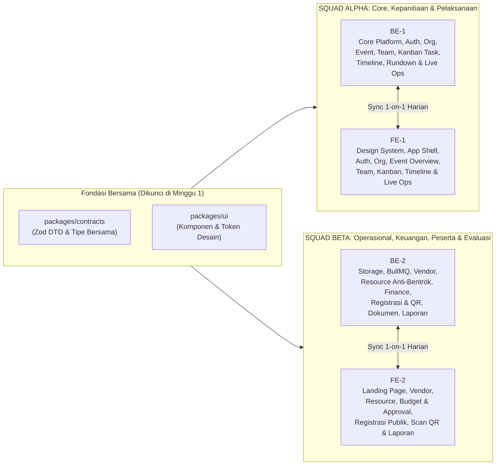

# 02 — Pembagian Kerja Tim 4 Orang (2 BE + 2 FE) & Peta Modul

Dokumen ini menjawab pertanyaan paling krusial saat membangun SaaS sebesar **EventOps** berempat: **bagaimana membagi 41 layar dan puluhan tabel agar beban kerja adil, tidak saling tunggu, dan tidak pernah tabrakan kode di Git?**

---

## 1. Strategi Pembagian: 2 Squad Vertikal (Bukan Pisah Tembok FE vs BE)

Kesalahan paling umum tim 4 orang adalah membiarkan 2 BE jalan sendiri dan 2 FE jalan sendiri tanpa pasangan tetap. Akibatnya, ketika ada perubahan kecil di fitur *Rundown* atau *Expense*, ke-4 orang harus rapat terus-menerus.

Solusi terbaik untuk EventOps adalah membentuk **2 Squad Fungsional Berpasangan (1 BE + 1 FE per Squad)**:

### Panduan Memilih Kursi untuk Teman Satu Tim
| Kursi | Cocok untuk Teman yang Suka / Kuat di... | Beban Layar / Modul |
| :--- | :--- | :--- |
| **BE-1** | Arsitektur sistem, autentikasi/keamanan RBAC, logika relasi task/dependency, dan komunikasi real-time (SSE/WebSocket). | Core Infra + 4 Modul Besar (~16 tabel) |
| **BE-2** | Logika bisnis transaksional (keuangan Rupiah, deteksi jadwal bentrok), antrean background job (WA/Email), upload S3/R2, QR security, dan agregasi laporan. | Support Infra + 5 Modul Besar (~18 tabel) |
| **FE-1** | Merapikan *Design System*, navigasi dashboard kompleks, interaksi *drag-and-drop* (Kanban & Rundown), serta tampilan kontrol langsung (*Live Operations*). | Design System + Shell + 20 Layar |
| **FE-2** | Landing page produk yang memikat, form dinamis, tabel data kaya fitur, alur keuangan/approval, pemindai kamera QR di HP, grafik laporan, dan cetak tiket. | Public Layout + QR + Charts + 21 Layar |

---

## 2. Pemetaan Lengkap 41 Layar Blueprint ke 4 Anggota Tim

Seluruh 41 layar dari [EventOps_WebApp_Blueprint.md](../EventOps_WebApp_Blueprint.md) telah terbagi habis tanpa ada area abu-abu:

### A. Area Squad Alpha (`FE-1` + `BE-1`) — 20 Layar + App Shell
| Screen Blueprint | Nama Halaman (UI Indonesia) | Route Next.js (`apps/web`) | Owner FE | Owner BE | Modul API Utama |
| :--- | :--- | :--- | :---: | :---: | :--- |
| **Screen 2** | Masuk & Daftar Akun | `/login`, `/register` | **FE-1** | **BE-1** | `auth` |
| **Screen 3** | Onboarding: Buat / Gabung Organisasi | `/onboarding` | **FE-1** | **BE-1** | `organizations`, `invitations` |
| **Screen 4** | Buat Organisasi Baru | `/onboarding/create-org` | **FE-1** | **BE-1** | `organizations` |
| **Screen 5** | Undang Anggota Awal | `/onboarding/invite` | **FE-1** | **BE-1** *(antrean via BE-2)* | `organizations` |
| **Screen 6** | Ringkasan Organisasi | `/orgs/[orgSlug]/overview` | **FE-1** | **BE-1** | `organizations` |
| **Screen 7** | Daftar Event Organisasi | `/orgs/[orgSlug]/events` | **FE-1** | **BE-1** | `events` |
| **Screen 8** | Buat Event Baru | `/orgs/[orgSlug]/events/new` | **FE-1** | **BE-1** | `events` |
| **Screen 9** | Dashboard & Kesiapan Event | `/orgs/[orgSlug]/events/[eventId]/overview` | **FE-1** | **BE-1** *(baca ringkasan BE-2)* | `events/readiness` |
| **Screen 10** | Pengaturan, Batal & Arsip Event | `/orgs/[orgSlug]/events/[eventId]/settings` | **FE-1** | **BE-1** | `events` |
| **Screen 11** | Tim & Divisi Kepanitiaan | `/orgs/[orgSlug]/events/[eventId]/team` | **FE-1** | **BE-1** | `teams` |
| **Screen 12** | Papan Tugas (Kanban & Tabel) | `/orgs/[orgSlug]/events/[eventId]/tasks` | **FE-1** | **BE-1** | `tasks` |
| **Screen 13** | Panel Detail Tugas, Subtask & Komentar | `?taskId=[id]` (Drawer pada `/tasks` & `/me/tasks`) | **FE-1** | **BE-1** *(lampiran via BE-2)* | `tasks` |
| **Screen 14** | Tugas Saya (*My Workspace*) | `/me/tasks`, `/me/events`, `/me/invitations` | **FE-1** | **BE-1** | `tasks/me`, `events/me` |
| **Screen 15** | Linimasa Persiapan (*Timeline*) | `/orgs/[orgSlug]/events/[eventId]/timeline` | **FE-1** | **BE-1** | `timeline` |
| **Screen 16** | Susunan Acara (*Rundown*) | `/orgs/[orgSlug]/events/[eventId]/rundown` | **FE-1** | **BE-1** | `rundown` |
| **Screen 33** | Kendali Hari-H (*Live Operations*) | `/orgs/[orgSlug]/events/[eventId]/live` | **FE-1** | **BE-1** *(SSE stream)* | `rundown/live` |
| **Screen 38** | Anggota & Undangan Organisasi | `/orgs/[orgSlug]/members` | **FE-1** | **BE-1** | `organizations/members` |
| **Screen 39** | Pengaturan Organisasi & Hak Akses | `/orgs/[orgSlug]/settings` | **FE-1** | **BE-1** | `organizations/settings` |
| **Screen 41** | Profil & Preferensi Pribadi | `/me/profile` | **FE-1** | **BE-1** | `users/me` |
| *(Shell)* | Sidebar Organisasi, Switcher & Header Event | `src/components/layout/**` | **FE-1** | **BE-1** | Konteks Sesi |

### B. Area Squad Beta (`FE-2` + `BE-2`) — 21 Layar + Infrastruktur Pendukung
| Screen Blueprint | Nama Halaman (UI Indonesia) | Route Next.js (`apps/web`) | Owner FE | Owner BE | Modul API Utama |
| :--- | :--- | :--- | :---: | :---: | :--- |
| **Screen 1** | Landing Page, Fitur & Harga Paket | `/`, `/fitur`, `/harga` | **FE-2** | **BE-2** *(daftar paket publik)* | `subscriptions/plans` |
| **Screen 17** | Direktori Vendor Organisasi & Event | `/orgs/[orgSlug]/events/[eventId]/vendors` | **FE-2** | **BE-2** | `vendors` |
| **Screen 18** | Detail Kerjasama Vendor & Komparasi Quotation | `?engagementId=[id]` (Drawer/Halaman) | **FE-2** | **BE-2** | `vendors/engagements` |
| **Screen 19** | Inventaris Perlengkapan (*Resources*) | `/orgs/[orgSlug]/events/[eventId]/resources` | **FE-2** | **BE-2** | `resources` |
| **Screen 20** | Peminjaman Alat & Deteksi Bentrok | `/orgs/[orgSlug]/events/[eventId]/resources/bookings` | **FE-2** | **BE-2** | `resources/bookings` |
| **Screen 21** | Ringkasan Anggaran (*Budget Overview*) | `/orgs/[orgSlug]/events/[eventId]/budget` | **FE-2** | **BE-2** | `finance/budget` |
| **Screen 22** | Alokasi Pagu Kategori & Divisi | `/orgs/[orgSlug]/events/[eventId]/budget/allocation` | **FE-2** | **BE-2** | `finance/allocations` |
| **Screen 23** | Pengajuan Biaya & Persetujuan (*Expense*) | `/orgs/[orgSlug]/events/[eventId]/budget/expenses` | **FE-2** | **BE-2** | `finance/expenses` |
| **Screen 24** | Laporan & Ekspor Keuangan | `/orgs/[orgSlug]/events/[eventId]/budget/reports` | **FE-2** | **BE-2** | `finance/reports` |
| **Screen 25** | Pengaturan Form Registrasi & Halaman Daftar Publik | `/orgs/.../participants/setup` & `/e/[eventSlug]` | **FE-2** | **BE-2** | `registrations/public` |
| **Screen 26** | Daftar Pendaftar & Moderasi Peserta | `/orgs/[orgSlug]/events/[eventId]/participants` | **FE-2** | **BE-2** | `registrations` |
| **Screen 27** | Halaman E-Ticket & Kode QR Peserta | `/tiket/[ticketCode]` | **FE-2** | **BE-2** | `registrations/tickets` |
| **Screen 28** | Pemindai Check-in QR Petugas | `/orgs/[orgSlug]/events/[eventId]/check-in` | **FE-2** | **BE-2** | `registrations/check-in` |
| **Screen 29** | Dashboard Kehadiran Peserta | `/orgs/[orgSlug]/events/[eventId]/participants/attendance` | **FE-2** | **BE-2** | `registrations/attendance` |
| **Screen 30** | Pusat Dokumen Operasional Event | `/orgs/[orgSlug]/events/[eventId]/documents` | **FE-2** | **BE-2** | `documents` |
| **Screen 31** | Pusat Notifikasi (*Popover & Halaman*) | `/me/notifications` + Bell Popover Header | **FE-2** | **BE-2** | `notifications` |
| **Screen 32** | Jejak Aktivitas (*Activity History*) | `/orgs/[orgSlug]/events/[eventId]/activities` | **FE-2** | **BE-2** *(membaca log BE-1 & BE-2)* | `activities` |
| **Screen 34** | Penutupan & Penyelesaian Event | Modal/Alur di `/reports` & `/settings` | **FE-2** | **BE-2** *(sinkron status BE-1)* | `reports/closure` |
| **Screen 35** | Laporan Akhir Lintas Modul | `/orgs/[orgSlug]/events/[eventId]/reports` | **FE-2** | **BE-2** | `reports/summary` |
| **Screen 36** | Evaluasi & *Retrospective* Panitia | `/orgs/[orgSlug]/events/[eventId]/reports/retrospective` | **FE-2** | **BE-2** | `reports/retrospective` |
| **Screen 37** | Buat Template dari Event Selesai | `/orgs/[orgSlug]/events/[eventId]/reports/template` | **FE-2** | **BE-2** | `reports/templates` |
| **Screen 40** | Paket Langganan, Kuota & Pembayaran QRIS/VA | `/orgs/[orgSlug]/subscription` | **FE-2** | **BE-2** | `subscriptions` |

---

## 3. Cara Menangani Titik Singgung Antar-Squad (Tanpa Saling Blokir)

Ada 4 titik alami tempat fitur Squad Alpha dan Squad Beta bertemu. Berikut kontrak antarmuka internalnya supaya kalian tidak rebutan file:

1. **Upload Lampiran pada Task (`FE-1`/`BE-1` memakai infrastruktur `BE-2`):**
   - `BE-2` menyediakan satu endpoint generik `/api/v1/uploads/presign` yang menghasilkan `uploadUrl` dan `fileKey`.
   - `FE-1` memanggil endpoint tersebut saat panitia melampirkan poster di Task Detail, lalu mengirim `fileKey` ke endpoint `POST /tasks/:taskId/attachments` milik `BE-1`.
2. **Pengiriman Notifikasi Lintas Modul (`BE-1` memicu notifikasi `BE-2`):**
   - `BE-1` membuat interface/port `NotificationPublisherPort` di `apps/api/src/core/ports/`.
   - Saat task ditugaskan atau jadwal rundown berubah, `BE-1` cukup memanggil `notificationPublisher.publish(...)`. Implementasi simpan ke tabel `notifications` + kirim WA/Email via BullMQ dikerjakan terpisah oleh `BE-2`.
3. **Angka Ringkasan pada Event Overview (`Screen 9` milik `FE-1`/`BE-1`):**
   - Dashboard Event membutuhkan metrik Vendor terkonfirmasi (`6/8`), Konflik Resource (`1`), dan Anggaran (`Rp50.000.000` vs `Rp12.450.000`).
   - `BE-2` mengekspor fungsi query baca-saja `OperationalSnapshotReader.getEventMetrics(eventId)` yang dipanggil oleh `EventOverviewService` milik `BE-1`.
4. **Komponen Popover Notifikasi di Topbar (`FE-2` memasang komponen ke Shell `FE-1`):**
   - `FE-1` menyiapkan slot `<NotificationBellSlot />` di Topbar; `FE-2` membangun isi komponen `<NotificationBellPopover />` di `src/features/notifications/` lalu menyambungkannya lewat 1 baris import.

---

## 4. Roadmap Pembagian Tugas Siap Jalan (6 Sprint / 12 Minggu)

Daftar pekerjaan di bawah ini **sudah langsung bisa dibagi ke 4 orang sejak Hari ke-1** (1 Sprint = 2 Minggu).

### Sprint 1 (Minggu 1–2): Fondasi Monorepo, Auth, Organisasi & Landing Page
- **`[S1-BE1]` Backend 1:** Setup NestJS 11 Fastify + Prisma v7 + `ZodValidationPipe` + Global Error Filter Indonesia; implementasi Auth (Register, Login, Refresh Cookie, Logout), CRUD Organisasi, Undangan Anggota, serta Guard `@RequireOrgRole()`.
- **`[S1-BE2]` Backend 2:** Setup `docker-compose.yml` (Postgres 17, Redis 7, MinIO, Mailpit); implementasi modul `uploads/presign` (S3/R2), BullMQ worker dasar + pengiriman email undangan via Mailpit/Resend, tabel `ActivityLog` & `Notification` dasar, serta seed paket langganan (`SubscriptionPlan`).
- **`[S1-FE1]` Frontend 1:** Setup `packages/ui` (Tailwind v4, token `DESIGN.md`, komponen Button/Input/Dialog/Drawer/Badge, formatter Rupiah & tanggal Indonesia), `proxy.ts` Next.js 16, halaman Login & Register (Screen 2), Onboarding Buat/Gabung Organisasi & Undang Anggota (Screen 3–5), App Shell Organisasi, serta halaman Anggota & Pengaturan Organisasi (Screen 6, 38, 39, 41).
- **`[S1-FE2]` Frontend 2:** Bangun Landing Page berbahasa Indonesia yang tajam dengan pratinjau produk interaktif, halaman Fitur, dan halaman Harga Paket dalam Rupiah (Screen 1); bangun komponen Pusat Notifikasi (Screen 31) & halaman Langganan awal (Screen 40).

### Sprint 2 (Minggu 3–4): Event Workspace, Kepanitiaan, Direktori Vendor & Inventaris Resource
- **`[S2-BE1]` Backend 1:** Modul `Events` (Buat Event, Draft, Filter Daftar Event, Status Machine Event, Batal dengan alasan, Arsip) + Modul `Teams` (CRUD Divisi, Penunjukan Leader, Penambahan Panitia ke banyak divisi, Guard `@RequireEventPermission()`).
- **`[S2-BE2]` Backend 2:** Modul `Vendors` (Database Vendor Organisasi, Engagement ke Event, pencatatan multi-Quotation, histori perubahan harga/status) + Modul `Resources` (Inventaris barang organisasi & mesin **Anti-Conflict Booking** lintas event di dalam transaksi database).
- **`[S2-FE1]` Frontend 1:** Halaman Daftar Event Organisasi card/table view (Screen 7), Form Buat Event zona waktu WIB/WITA/WIT (Screen 8), Navigasi Kontekstual Event Workspace, Pengaturan Event (Screen 10), dan halaman Struktur Kepanitiaan & Divisi (Screen 11).
- **`[S2-FE2]` Frontend 2:** Halaman Direktori Vendor & Drawer Perbandingan Quotation (Screen 17–18), serta Halaman Inventaris Perlengkapan & Form Booking lengkap dengan Banner Peringatan Konflik Jadwal Lintas Event (Screen 19–20).

### Sprint 3 (Minggu 5–6): Kanban Task, Tugas Saya, Anggaran (RAB) & Pengajuan Pengeluaran
- **`[S3-BE1]` Backend 1:** Modul `Tasks` lengkap (CRUD Task, perpindahan kolom Kanban & urutan kartu, Checklist/Subtasks, relasi `TaskDependency` pemicu informasi blocker, Komentar Task, kondisi otomatis `isOverdue`, dan endpoint lintas-event `/me/tasks`).
- **`[S3-BE2]` Backend 2:** Modul `Finance` lengkap (Pagu Anggaran Event, Alokasi per Kategori & Divisi, Pengajuan `ExpenseRequest` ber-Idempotency Key, alur Approval/Reject berjenjang, pencatatan `PaymentRecord` terpisah, aturan *Re-Approval* saat nominal diubah, dan rumus `Planned / Committed / Actual / Remaining`).
- **`[S3-FE1]` Frontend 1:** Papan Kanban 6 Kolom dengan `@dnd-kit` + List View + Filter Prioritas/Divisi/Overdue (Screen 12), Slide-over Drawer Detail Task lengkap (Screen 13), serta halaman *My Workspace / Tugas Saya* bagi anggota panitia (Screen 14).
- **`[S3-FE2]` Frontend 2:** Dashboard Keuangan Event (Screen 21), Halaman Alokasi Anggaran dengan indikator batas pagu (Screen 22), Form & Drawer Pengajuan Biaya + Upload Nota + Antrean Persetujuan (Screen 23), serta Laporan Keuangan & Ekspor CSV (Screen 24).

### Sprint 4 (Minggu 7–8): Timeline, Rundown, Registrasi Peserta Publik & Tiket QR
- **`[S4-BE1]` Backend 1:** Modul `Timeline` (Milestone persiapan H-minus terhubung ke Task & progres otomatis) + Modul `Rundown` (Sesi acara multi-lokasi/multi-hari, urutan agenda, pemisahan waktu rencana `plannedStart/End` vs realisasi `actualStart/End`, pemicu notifikasi ke PIC sesi saat jadwal bergeser).
- **`[S4-BE2]` Backend 2:** Modul `Registrations` (Konfigurasi form publik kustom sesuai UU PDP, pendaftaran publik ber-rate-limit & kuota/waitlist, moderasi Approve/Reject, generator kode tiket unik bertanda tangan HMAC untuk QR) + Modul `Documents` (Manajemen berkas operasional event berizin akses).
- **`[S4-FE1]` Frontend 1:** Halaman *Preparation Timeline* interaktif dengan keterkaitan task (Screen 15) dan Halaman Penyusun *Rundown* acara lengkap dengan durasi otomatis & kebutuhan teknis (Screen 16).
- **`[S4-FE2]` Frontend 2:** Builder Pengaturan Registrasi & Halaman Pendaftaran Publik `/e/[eventSlug]` (Screen 25), Tabel Moderasi Pendaftar (Screen 26), Halaman E-Ticket QR Peserta siap simpan di HP (Screen 27), serta Halaman Pusat Dokumen Event (Screen 30).

### Sprint 5 (Minggu 9–10): Hari-H (Live Operations, Scan QR Lapangan) & Dashboard Kesiapan Terpadu
- **`[S5-BE1]` Backend 1:** *Event Readiness Engine* & agregasi penuh `Event Overview` (Screen 9: menarik snapshot dari modul BE-1 & BE-2, mendeteksi isu kritis otomatis), ditambah endpoint **SSE / WebSocket Live Operations** untuk menyiarkan pergantian sesi rundown aktual & isu terbuka secara real-time.
- **`[S5-BE2]` Backend 2:** Endpoint **Check-in Scanner Atomik** (tolak scan ke-2 dengan info jam & petugas scan pertama, tolak tiket batal, siarkan angka hadir real-time), query feed `Activity History` lengkap dengan filter objek/waktu, serta integrasi pembayaran paket langganan Midtrans/Xendit Sandbox (QRIS & Virtual Account).
- **`[S5-FE1]` Frontend 1:** Halaman *Event Overview / Readiness Dashboard* interaktif dengan tautan langsung ke item bermasalah (Screen 9) dan Layar *Event Day / Live Operations* ramah HP & tablet backstage (Screen 33).
- **`[S5-FE2]` Frontend 2:** Halaman Kamera *Check-in QR Scanner* berkecepatan tinggi dengan mode input kode manual (Screen 28), *Attendance Dashboard* real-time (Screen 29), Halaman *Activity History* (Screen 32), dan alur Checkout QRIS/VA di halaman Langganan (Screen 40).

### Sprint 6 (Minggu 11–12): Evaluasi Pasca-Acara, Template Reuse, Hardening Keamanan & QA Penuh
- **`[S6-BE1]` Backend 1:** Penguncian terukur untuk Event berstatus `COMPLETED` & `ARCHIVED` (rekonsiliasi pasca-acara tetap diizinkan bagi pengguna berwenang), audit seluruh matriks RBAC & isolasi multi-tenant, serta pengujian beban endpoint kritis.
- **`[S6-BE2]` Backend 2:** Modul `Post-Event Reports` lintas modul (operasional, keuangan, peserta, evaluasi vendor), CRUD `EventRetrospective`, dan mesin **Create Template from Event** (menyalin struktur divisi, task, milestone relatif H-minus, rundown, & kategori RAB **tanpa** menyalin data pribadi peserta dan transaksi uang).
- **`[S6-FE1]` Frontend 1:** Audit responsivitas menyeluruh (Desktop/Tablet/Mobile), aksesibilitas keyboard & kontras tema terang/gelap pada seluruh 20 layar Squad Alpha, serta pengujian E2E Playwright alur perencanaan hingga Live Rundown.
- **`[S6-FE2]` Frontend 2:** Halaman Penutupan Event, Laporan Akhir Lintas Modul, Form *Retrospective* Pembelajaran Tim, serta Wizard Buat Event Baru dari Template (Screen 34–37); audit responsivitas & pengujian E2E Playwright alur Keuangan hingga Scan QR pada 21 layar Squad Beta.
