# 03 — Kontrak Database PostgreSQL (Prisma v7), RBAC & State Machine

Dokumen ini menjadi kontrak data tunggal antara **BE-1**, **BE-2**, **FE-1**, dan **FE-2**. Setiap nama enum, relasi kunci asing, batasan unik, aturan perpindahan status, serta rumus angka ringkasan harus merujuk tepat ke spesifikasi ini.

---

## 1. Peta Relasi Entitas Utama (ERD)

```mermaid
erDiagram
    User ||--o{ OrganizationMember : "bergabung"
    Organization ||--o{ OrganizationMember : "memiliki"
    Organization ||--o{ OrganizationInvitation : "mengundang"
    Organization ||--o{ Subscription : "berlangganan"
    Organization ||--o{ Event : "menyelenggarakan"
    Organization ||--o{ Vendor : "menyimpan_database"
    Organization ||--o{ Resource : "memiliki_inventaris"
    Organization ||--o{ EventTemplate : "menyimpan_template"

    Event ||--o{ Division : "membagi_kepanitiaan"
    Event ||--o{ EventMember : "melibatkan"
    Division ||--o{ DivisionMember : "beranggotakan"
    EventMember ||--o{ DivisionMember : "masuk_ke"

    Event ||--o{ Task : "memiliki_pekerjaan"
    Task ||--o{ TaskChecklistItem : "memuat_subtask"
    Task ||--o{ TaskDependency : "bergantung_pada"
    Task ||--o{ TaskComment : "didiskusikan"

    Event ||--o{ PreparationMilestone : "memiliki_timeline"
    Event ||--o{ RundownSession : "memiliki_susunan_acara"

    Event ||--o{ VendorEngagement : "melibatkan_vendor"
    Vendor ||--o{ VendorEngagement : "terlibat_dalam"
    VendorEngagement ||--o{ VendorQuotation : "mengajukan_penawaran"

    Resource ||--o{ ResourceBooking : "dipinjam_lewat"
    Event ||--o{ ResourceBooking : "meminjam_alat"

    Event ||--|| EventBudget : "memiliki_pagu"
    EventBudget ||--o{ BudgetCategoryAllocation : "dialokasikan_ke"
    Event ||--o{ ExpenseRequest : "mencatat_pengajuan_biaya"
    ExpenseRequest ||--o{ ExpenseApprovalLog : "diputuskan_lewat"
    ExpenseRequest ||--o| PaymentRecord : "direalisasikan_oleh"

    Event ||--|| RegistrationConfig : "mengatur_pendaftaran"
    Event ||--o{ ParticipantRegistration : "menerima_peserta"
    ParticipantRegistration ||--o| CheckInRecord : "divalidasi_hadir"

    Event ||--o{ EventDocument : "menyimpan_berkas"
    Event ||--o| EventRetrospective : "dievaluasi_dalam"
    Organization ||--o{ ActivityLog : "merekam_jejak_audit"
```



---

## 2. Pembagian Multi-File Prisma Schema (`BE-1` vs `BE-2`)

Prisma v7 mendukung folder `apps/api/prisma/schema/*.prisma` sehingga **BE-1** dan **BE-2** mengedit file `.prisma` yang terpisah dan bebas konflik Git:

### A. File `00-base.prisma` (Konfigurasi & Enum Bersama)
```prisma
generator client {
  provider = "prisma-client-js"
}

datasource db {
  provider = "postgresql"
}

enum IndonesiaTimezone {
  ASIA_JAKARTA   // WIB (UTC+7)
  ASIA_MAKASSAR  // WITA (UTC+8)
  ASIA_JAYAPURA  // WIT (UTC+9)
}

enum OrgRole {
  OWNER
  ADMIN
  MEMBER
}

enum InvitationStatus {
  PENDING
  ACCEPTED
  REJECTED
  EXPIRED
  REVOKED
}

enum EventRole {
  EVENT_MANAGER
  DIVISION_LEADER
  COMMITTEE_MEMBER
  FINANCE_STAFF
  VIEWER
}

enum EventStatus {
  DRAFT
  PLANNING
  PREPARATION
  READY
  ONGOING
  COMPLETED
  CANCELLED
  ARCHIVED
}

enum TaskStatus {
  BACKLOG
  TODO
  IN_PROGRESS
  IN_REVIEW
  BLOCKED
  COMPLETED
  CANCELLED
}

enum TaskPriority {
  LOW
  MEDIUM
  HIGH
  URGENT
}

enum RundownSessionStatus {
  PLANNED
  READY
  IN_PROGRESS
  DELAYED
  COMPLETED
  CANCELLED
}

enum VendorEngagementStatus {
  PROSPECT
  CONTACTED
  QUOTATION_RECEIVED
  UNDER_REVIEW
  APPROVED
  CONFIRMED
  COMPLETED
  CANCELLED
}

enum ResourceBookingStatus {
  REQUESTED
  APPROVED
  REJECTED
  IN_USE
  RETURNED
  CANCELLED
}

enum ExpenseStatus {
  DRAFT
  SUBMITTED
  UNDER_REVIEW
  APPROVED
  REJECTED
  PAID
  CANCELLED
}

enum RegistrationStatus {
  PENDING
  APPROVED
  REJECTED
  WAITLISTED
  CANCELLED
}
```

### B. Tabel Milik **BE-1** (`01-identity-org.prisma`, `02-event-team.prisma`, `03-task-schedule.prisma`)

| Nama Tabel (`@@map`) | File Prisma | Kolom Kunci & Indeks Wajib | Aturan Penting |
| :--- | :--- | :--- | :--- |
| `users` | `01-identity-org` | `id (uuid)`, `full_name`, `email (unique)`, `phone_wa`, `password_hash`, `avatar_key`, `preferred_theme` | Menyimpan akun lintas organisasi. |
| `organizations` | `01-identity-org` | `id (uuid)`, `name`, `slug (unique)`, `logo_key`, `description`, `created_by_id` | Konteks tenant utama seluruh data kerja. |
| `organization_members` | `01-identity-org` | `id`, `organization_id`, `user_id`, `role (OrgRole)`, `is_active` — `@@unique([organization_id, user_id])` | Jika `is_active = false`, seluruh akses ke event organisasi otomatis gugur. |
| `organization_invitations` | `01-identity-org` | `id`, `organization_id`, `email`, `role`, `token_hash (unique)`, `status (InvitationStatus)`, `expires_at` | Mendukung status `PENDING`, `ACCEPTED`, `REJECTED`, `EXPIRED`, `REVOKED`. |
| `events` | `02-event-team` | `id`, `organization_id`, `slug`, `name`, `category`, `start_at (timestamptz)`, `end_at (timestamptz)`, `timezone (IndonesiaTimezone)`, `location_name`, `location_address`, `capacity`, `status (EventStatus)`, `readiness_override_reason`, `cancel_reason`, `manager_user_id` — `@@unique([organization_id, slug])`, `@@index([organization_id, status, start_at])` | Pusat operasional acara. |
| `divisions` | `02-event-team` | `id`, `event_id`, `name`, `description`, `leader_event_member_id` — `@@unique([event_id, name])` | Contoh: Program, Publikasi, Logistik, Keuangan. |
| `event_members` | `02-event-team` | `id`, `event_id`, `org_member_id`, `event_role (EventRole)`, `can_view_budget (bool)`, `can_approve_expense (bool)`, `can_manage_checkin (bool)` — `@@unique([event_id, org_member_id])` | Menghubungkan anggota organisasi ke event beserta izin spesifik. |
| `division_members` | `02-event-team` | `division_id`, `event_member_id` — `@@id([division_id, event_member_id])` | Satu anggota panitia boleh tergabung di lebih dari satu divisi (Blueprint Screen 11). |
| `tasks` | `03-task-schedule` | `id`, `organization_id`, `event_id`, `division_id`, `milestone_id`, `rundown_session_id`, `title`, `description`, `status (TaskStatus)`, `priority (TaskPriority)`, `board_order (float)`, `assignee_event_member_id`, `creator_user_id`, `due_at (timestamptz)`, `blocked_reason`, `completed_at` — `@@index([event_id, status, board_order])`, `@@index([assignee_event_member_id, status, due_at])` | `isOverdue` dihitung dinamis (`due_at < now() && status NOT IN ('COMPLETED','CANCELLED')`), bukan disimpan sebagai kolom status. |
| `task_checklist_items` | `03-task-schedule` | `id`, `task_id`, `title`, `is_completed`, `sort_order` | Subtask/checklist di dalam Drawer Task. |
| `task_dependencies` | `03-task-schedule` | `task_id`, `depends_on_task_id` — `@@id([task_id, depends_on_task_id])` | Mencegah *circular dependency*; jika `depends_on_task_id` belum `COMPLETED`, UI menampilkan penanda hambatan. |
| `task_comments` | `03-task-schedule` | `id`, `task_id`, `author_user_id`, `body`, `created_at` | Diskusi revisi dan progres per task. |
| `preparation_milestones` | `03-task-schedule` | `id`, `event_id`, `title`, `target_date (date)`, `pic_event_member_id`, `description`, `sort_order` | Linimasa persiapan H-minus sebelum hari acara. |
| `rundown_sessions` | `03-task-schedule` | `id`, `event_id`, `title`, `stage_or_room`, `planned_start_at`, `planned_end_at`, `actual_start_at`, `actual_end_at`, `division_id`, `pic_event_member_id`, `technical_notes`, `status (RundownSessionStatus)`, `sort_order` — `@@index([event_id, planned_start_at])` | Waktu rencana (`planned_*`) **tidak pernah ditimpa** saat mencatat waktu aktual (`actual_*`) pada hari-H. |

### C. Tabel Milik **BE-2** (`04-vendor-res.prisma`, `05-finance.prisma`, `06-registration.prisma`, `07-ops-platform.prisma`)

| Nama Tabel (`@@map`) | File Prisma | Kolom Kunci & Indeks Wajib | Aturan Penting |
| :--- | :--- | :--- | :--- |
| `vendors` | `04-vendor-res` | `id`, `organization_id`, `name`, `category`, `contact_name`, `phone_wa`, `email`, `address`, `notes`, `average_rating` — `@@index([organization_id, category])` | Database vendor tingkat organisasi (bisa dipakai ulang lintas event). |
| `vendor_engagements` | `04-vendor-res` | `id`, `event_id`, `vendor_id`, `service_scope`, `status (VendorEngagementStatus)`, `agreed_amount_idr (BigInt?)`, `delivery_start_at`, `delivery_end_at`, `evaluation_score`, `evaluation_notes` | Status `CONFIRMED` menandakan kesepakatan kerja, **bukan** bukti pembayaran lunas. |
| `vendor_quotations` | `04-vendor-res` | `id`, `engagement_id`, `version_label`, `quoted_amount_idr (BigInt)`, `document_id`, `notes`, `is_selected (bool)` | Menyimpan beberapa penawaran harga untuk dibandingkan sebelum dipilih. |
| `resources` | `04-vendor-res` | `id`, `organization_id`, `name`, `category`, `source_type (OWNED/RENTED/VENDOR/BORROWED)`, `total_quantity (int)`, `available_condition`, `storage_location` | Inventaris barang/fasilitas organisasi (misal: 3 Proyektor, 12 HT). |
| `resource_bookings` | `04-vendor-res` | `id`, `organization_id`, `resource_id`, `event_id`, `requested_by_member_id`, `quantity (int)`, `start_at (timestamptz)`, `end_at (timestamptz)`, `status (ResourceBookingStatus)`, `condition_before`, `condition_after`, `notes` — `@@index([resource_id, status, start_at, end_at])` | Hanya booking berstatus `APPROVED` dan `IN_USE` yang mengunci stok final; `REQUESTED` memunculkan *Conflict Warning* bila melebihi kapasitas. |
| `event_budgets` | `05-finance` | `id`, `event_id (unique)`, `total_planned_idr (BigInt)`, `currency ('IDR')`, `notes` | Pagu utama anggaran event dalam Rupiah bulat. |
| `budget_category_allocations` | `05-finance` | `id`, `event_budget_id`, `category_name`, `division_id (nullable)`, `planned_amount_idr (BigInt)` | Rincian pagu per kategori (Venue, Konsumsi, Peralatan, Pembicara, Publikasi, Transpor) & divisi. |
| `expense_requests` | `05-finance` | `id`, `organization_id`, `event_id`, `budget_category_id`, `division_id`, `vendor_engagement_id (nullable)`, `requester_member_id`, `title`, `description`, `amount_idr (BigInt)`, `approved_amount_idr (BigInt?)`, `expense_date (date)`, `status (ExpenseStatus)`, `idempotency_key (unique)` — `@@index([event_id, status])` | Jika `amount_idr` diedit setelah status `APPROVED`, status wajib kembali ke `UNDER_REVIEW`. |
| `expense_approval_logs` | `05-finance` | `id`, `expense_request_id`, `reviewer_user_id`, `decision (APPROVED/REJECTED/RESET)`, `amount_snapshot_idr (BigInt)`, `note`, `created_at` | Riwayat persetujuan biaya yang tidak boleh dihapus. |
| `payment_records` | `05-finance` | `id`, `expense_request_id (unique)`, `paid_amount_idr (BigInt)`, `paid_at (timestamptz)`, `payment_method`, `reference_number`, `proof_document_id`, `recorded_by_user_id` | Satu-satunya sumber angka **Actual Expense**. Record berstatus `PAID` tidak dapat dihapus normal. |
| `registration_configs` | `06-registration` | `id`, `event_id (unique)`, `is_open (bool)`, `requires_approval (bool)`, `max_capacity (int?)`, `enable_waitlist (bool)`, `enable_qr_ticket (bool)`, `custom_fields_schema (jsonb)`, `privacy_notice_text` | Pengaturan form publik patuh prinsip minimalisasi data UU PDP. |
| `participant_registrations` | `06-registration` | `id`, `event_id`, `registration_code (unique)`, `qr_token_hash (unique)`, `full_name`, `email`, `phone_wa (nullable)`, `institution (nullable)`, `custom_answers (jsonb)`, `status (RegistrationStatus)`, `registered_at` — `@@unique([event_id, email])`, `@@index([event_id, status])` | Satu email hanya satu pendaftaran aktif per event. |
| `check_in_records` | `06-registration` | `id`, `registration_id (unique)`, `event_id`, `checked_in_at (timestamptz)`, `scanned_by_user_id`, `scanner_device_label`, `method (QR_SCAN/MANUAL_LOOKUP)` | Constraint `registration_id (unique)` di level PostgreSQL menjamin **mustahil check-in dua kali**. |
| `event_documents` | `07-ops-platform` | `id`, `organization_id`, `event_id`, `uploaded_by_user_id`, `title`, `category`, `storage_key`, `mime_type`, `size_bytes (BigInt)`, `visibility_scope (ALL_EVENT/MANAGERS_ONLY/FINANCE_ONLY/DIVISION_ONLY)`, `linked_entity_type`, `linked_entity_id` | Menyimpan dokumen acara maupun lampiran task/vendor/nota biaya. |
| `notifications` | `07-ops-platform` | `id`, `recipient_user_id`, `organization_id`, `event_id (nullable)`, `type`, `title`, `body`, `target_url`, `read_at (nullable)`, `created_at` — `@@index([recipient_user_id, read_at, created_at])` | Pemberitahuan personal (berbeda dari `activity_logs`). |
| `activity_logs` | `07-ops-platform` | `id`, `organization_id`, `event_id (nullable)`, `actor_user_id`, `action`, `entity_type`, `entity_id`, `before_json (jsonb)`, `after_json (jsonb)`, `reason`, `created_at` — `@@index([event_id, created_at])` | Jejak audit permanen (*append-only*) dipakai bersama oleh BE-1 & BE-2. |
| `event_retrospectives` | `07-ops-platform` | `id`, `event_id (unique)`, `went_well`, `issues_happened`, `root_causes`, `impacts`, `solutions_taken`, `recommendations_next`, `updated_by_user_id` | Pembelajaran pasca-acara (Screen 36). |
| `event_templates` | `07-ops-platform` | `id`, `organization_id`, `source_event_id (nullable)`, `name`, `description`, `structure_payload (jsonb)` | Menyimpan cetak biru divisi, task relatif H-minus, kerangka rundown, dan kategori RAB **tanpa PII peserta & tanpa transaksi uang**. |
| `subscriptions` | `07-ops-platform` | `id`, `organization_id (unique)`, `plan_code (STARTER/PRO/ENTERPRISE)`, `status (ACTIVE/PAST_DUE/GRACE_PERIOD/READ_ONLY)`, `max_active_events`, `max_members`, `current_period_end`, `payment_gateway_ref` | Bila masa aktif habis, masuk `GRACE_PERIOD` lalu `READ_ONLY` (data tidak dihapus mendadak). |

---

## 3. Matriks Hak Akses 2 Tingkat (RBAC)

Sesuai Bab 6 Blueprint, menjadi anggota organisasi **tidak otomatis** membuka seluruh data sensitif event (seperti RAB dan data pribadi peserta):

| Aksi / Modul | Org Owner | Org Admin | Event Manager | Division Leader | Committee Member | Finance Staff | Viewer / Client |
| :--- | :---: | :---: | :---: | :---: | :---: | :---: | :---: |
| Kelola Organisasi, Billing & Role Org | Penuh | Terbatas* | — | — | — | — | — |
| Buat Event & Buat Template Event | Ya | Ya | Ya (Event-nya) | — | — | — | — |
| Override Status `READY`, Batal / Arsip Event | Ya | Ya | Ya (wajib alasan) | — | — | — | — |
| Kelola Divisi & Anggota Kepanitiaan | Ya | Ya | Ya | Divisinya | Baca Struktur | Baca Struktur | Baca Ringkas |
| Buat / Edit / Geser Status Task | Semua | Semua | Semua | Divisinya | Task Miliknya | Task Keuangan | Hanya Lihat* |
| Ubah Jadwal *Rundown* & Catat Waktu Aktual | Ya | Ya | Ya | Sesi Divisinya | PIC Sesi* | — | Baca Rundown |
| Kelola Vendor, Quotation & Booking Alat | Ya | Ya | Ya | Ajukan Divisi | Ajukan Divisi* | Baca Quotation | — |
| Lihat Detail RAB, Pengajuan Biaya & Nota | Ya | Opsional | Ya | Ringkas Divisi | Pengajuan Sendiri | **Penuh** | — |
| Setujui / Tolak Pengeluaran (*Approve Expense*) | Ya | — | Ya | — | — | Buat & Catat Bayar* | — |
| Lihat PII Peserta & Ekspor Daftar Hadir | Ya | Opsional | Ya | Petugas Izin* | — | — | Ringkasan Angka |
| Scan QR Check-in Hari-H | Ya | Ya | Ya | Petugas Izin | Petugas Izin | — | — |

*\*Keterangan: Pembuat pengajuan biaya (`Finance Staff`) tidak boleh menyetujui (`Approve`) pengajuannya sendiri kecuali diizinkan khusus pada organisasi 1 orang (pemisahan tugas Maker–Approver).*

---

## 4. Kontrak 5 State Machine & Aturan Invariant

### 4.1 Status Event (`EventStatus`)
`DRAFT` → `PLANNING` → `PREPARATION` → `READY` → `ONGOING` → `COMPLETED` → `ARCHIVED` *(serta cabang `CANCELLED` dari status sebelum `COMPLETED`)*.
- **Invariant `READY`:** Sistem menghitung otomatis kriteria kesiapan. Jika belum seluruh kriteria terpenuhi namun Event Manager memaksa ubah ke `READY`, field `readinessOverrideReason` **wajib diisi minimal 15 karakter** dan dicatat ke `activity_logs`.
- **Invariant `CANCELLED`:** Wajib mengisi `cancelReason` dan konfirmasi eksplisit.
- **Invariant `ARCHIVED`:** Menolak mutasi CRUD operasional biasa (`409 EVENT_IS_ARCHIVED`).

### 4.2 Status Task (`TaskStatus`) & Kondisi `isOverdue`
`BACKLOG` ↔ `TODO` ↔ `IN_PROGRESS` ↔ `IN_REVIEW` → `COMPLETED` *(dapat berpindah ke `BLOCKED` wajib isi `blockedReason`, atau `CANCELLED`)*.
- **Invariant `isOverdue`:** Bukan nilai enum `TaskStatus`. API selalu mengembalikan field boolean terhitung `isOverdue: Boolean(task.dueAt && task.dueAt < now && !['COMPLETED', 'CANCELLED'].includes(task.status))`.

### 4.3 Status Kerjasama Vendor (`VendorEngagementStatus`)
`PROSPECT` → `CONTACTED` → `QUOTATION_RECEIVED` → `UNDER_REVIEW` → `APPROVED` → `CONFIRMED` → `COMPLETED` *(+ `CANCELLED`)*.
- **Invariant Pemisahan Pembayaran:** Status `CONFIRMED` tidak mengubah angka *Actual Expense*. Pengeluaran aktual hanya bertambah ketika `ExpenseRequest` terkait telah memiliki `PaymentRecord` (`PAID`).

### 4.4 Status Pengajuan Biaya (`ExpenseStatus`)
`DRAFT` → `SUBMITTED` → `UNDER_REVIEW` → `APPROVED` → `PAID` *(+ `REJECTED` yang dapat direvisi kembali ke `SUBMITTED`, serta `CANCELLED` sebelum `PAID`)*.
- **Invariant Perubahan Nominal:** Apabila `amountIdr` diubah saat status `APPROVED`, service wajib otomatis menurunkan status menjadi `UNDER_REVIEW`, menulis log `RESET` di `expense_approval_logs`, dan mengirim notifikasi ulang ke Approver.
- **Invariant Immutability `PAID`:** Endpoint `DELETE` atau edit nominal langsung pada pengeluaran berstatus `PAID` wajib ditolak (`409 EXPENSE_ALREADY_PAID`).

### 4.5 Status Registrasi Peserta & QR Check-in (`RegistrationStatus`)
`PENDING` → `APPROVED` / `REJECTED` / `WAITLISTED` *(+ `CANCELLED`)*.
- **Invariant Check-in Sekali Pakai:** Hanya peserta berstatus `APPROVED` yang dapat melakukan Check-in. Eksekusi wajib atomik; percobaan scan kedua mengembalikan `409 TICKET_ALREADY_CHECKED_IN` beserta nama petugas dan jam scan pertama.

---

## 5. Kontrak Rumus Angka Bisnis (Wajib Seragam BE & FE)

### A. Rumus *Budget Snapshot* (Screen 9, 21, 24, 35)
Untuk satu `eventId`:
- **`plannedIdr`** = `event_budgets.total_planned_idr`
- **`committedIdr`** = $\sum$ `approved_amount_idr` pada `expense_requests` dengan `status = 'APPROVED'` *(sudah disetujui, uang terikat komitmen, namun belum dibayar)*
- **`actualIdr`** = $\sum$ `paid_amount_idr` pada `payment_records` dari `expense_requests` dengan `status = 'PAID'` *(uang benar-benar keluar)*
- **`remainingIdr`** = `plannedIdr - committedIdr - actualIdr` *(dapat bernilai negatif jika defisit/overbudget, ditandai merah di UI)*
- **`pendingApprovalIdr`** = $\sum$ `amount_idr` pada `expense_requests` dengan `status IN ('SUBMITTED', 'UNDER_REVIEW')` *(ditampilkan terpisah sebagai informasi antrean, belum memotong Remaining)*

### B. Rumus Deteksi Bentrok Perlengkapan (*Resource Conflict* — Screen 9 & 20)
Dua peminjaman pada `resourceId` yang sama dinyatakan **beririsan waktu** apabila:
$$\text{existing.startAt} < \text{requested.endAt} \quad \text{DAN} \quad \text{existing.endAt} > \text{requested.startAt}$$
- Kapasitas terpakai pada titik irisan maksimum = $\sum \text{quantity}$ seluruh booking berstatus `APPROVED` atau `IN_USE`.
- Permintaan baru berstatus `REQUESTED` dengan `requestedQty + maxAllocatedInWindow > resource.totalQuantity` menghasilkan flag `hasConflict: true` dan `shortageQty`, serta **diblokir untuk di-Approve** sampai jumlah/waktu disesuaikan.

### C. Kriteria *Event Readiness Engine* (Screen 9)
Sistem mengevaluasi status kesiapan otomatis menjadi `READY`, `NEEDS_ATTENTION`, atau `CRITICAL`:
1. Tidak ada task berstatus `BLOCKED` dengan prioritas `HIGH`/`URGENT`.
2. Tidak ada task yang melewati deadline (`isOverdue === true`).
3. Tidak ada `ResourceBooking` aktif yang mengalami konflik kuota.
4. Minimal 1 sesi `RundownSession` telah tersusun dan memiliki PIC.
5. Realisasi + komitmen anggaran (`committedIdr + actualIdr`) tidak melampaui `plannedIdr` (kecuali telah disetujui penyesuaian pagu).
Jika kelima poin terpenuhi -> `READY`; jika ada pelanggaran H-7 acara -> `CRITICAL`; selain itu -> `NEEDS_ATTENTION`.
